# electrocasa-lakehouse
Plataforma de ingeniería de datos para una cadena de electrodomésticos usando Databricks y arquitectura Medallion.

# Evidencias de gobierno y seguridad – ElectroCasa

## 1. Grupo de Ingeniería

La captura muestra que `electrocasa_ingenieria` tiene como miembro al usuario del proyecto.

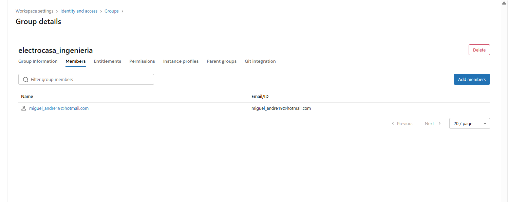

## 2. Consulta de empleados con acceso de Ingeniería

La consulta de `electrocasa.silver.empleados` muestra los valores reales de DNI y salario para el usuario miembro de `electrocasa_ingenieria`.

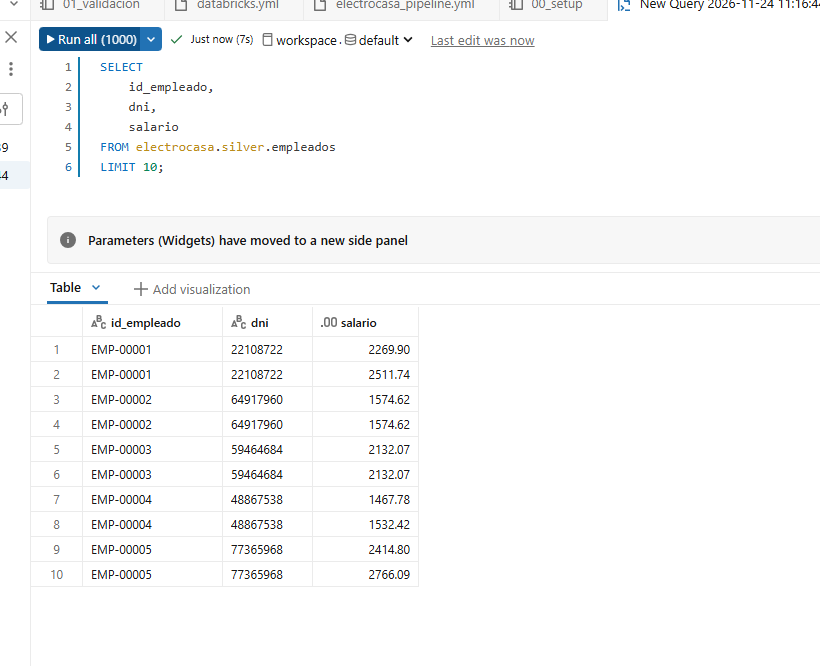

## 3. Definición de máscaras en la materialized view

`SHOW CREATE TABLE` confirma que las columnas `dni` y `salario` tienen asociadas las funciones de máscara `mask_dni` y `mask_salario`.

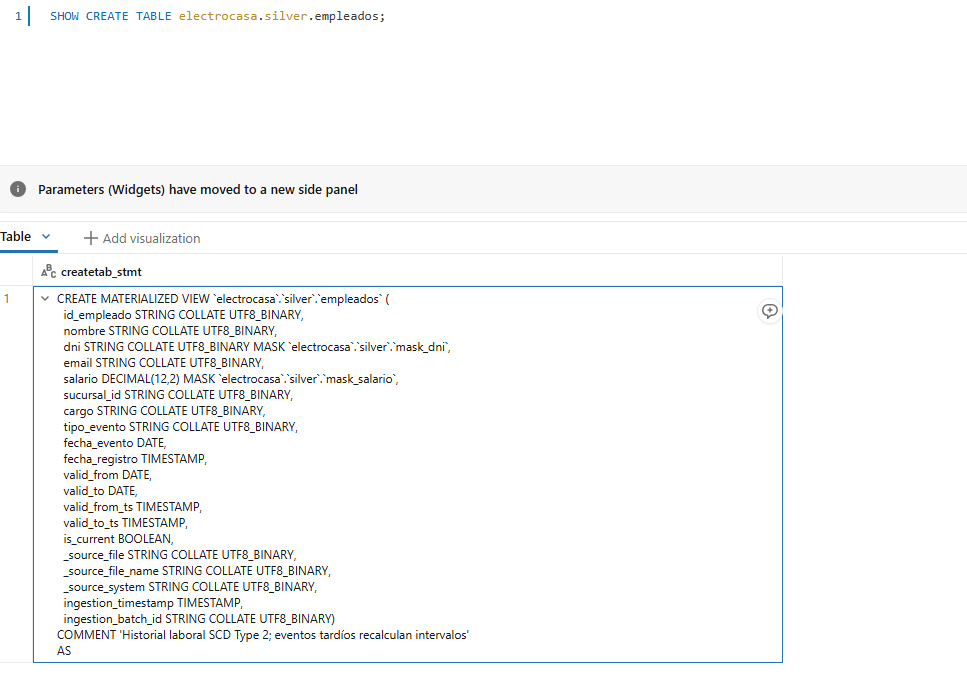

## 4. GRANT temporal: antes del REVOKE

Se otorgó temporalmente `SELECT` al grupo `electrocasa_analistas` sobre el esquema `electrocasa.silver` para demostrar la revocación posterior.

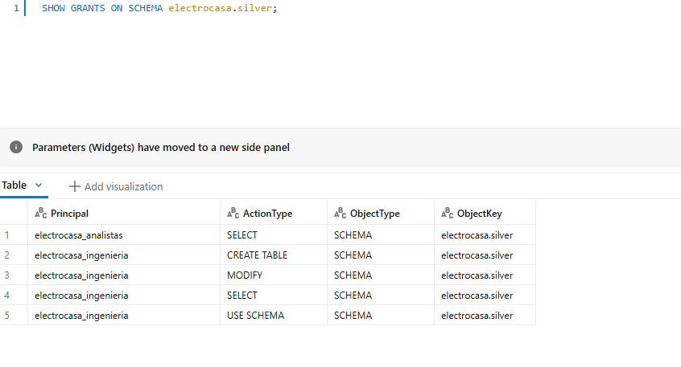

## 5. REVOKE: después de revocar SELECT

Se revocó el permiso temporal `SELECT` de `electrocasa_analistas` sobre `electrocasa.silver`. La consulta `SHOW GRANTS` confirma que el grupo ya no aparece con ese permiso.

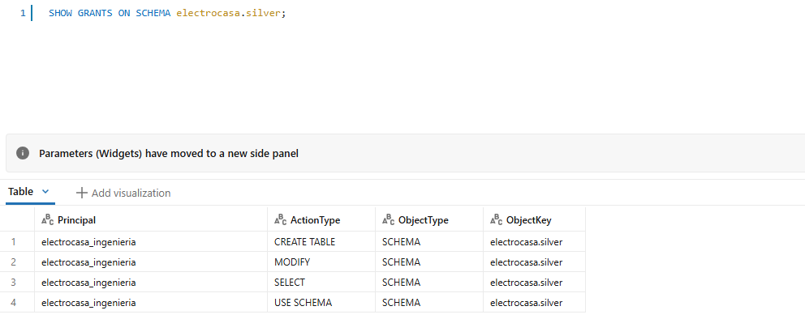

## 6. Acceso de Auditoría al catálogo `system`

Se intentó otorgar al grupo `electrocasa_auditoria` el privilegio `USE CATALOG` sobre el catálogo `system`:

```sql
GRANT USE CATALOG ON CATALOG system
TO `electrocasa_auditoria`;
```

**Resultado:** Databricks Free Edition rechazó la operación porque el usuario no tiene el privilegio `MANAGE` sobre el catálogo `system`.

Error obtenido:

```text
PERMISSION_DENIED: User does not have MANAGE on Catalog 'system'.
```

De acuerdo con las instrucciones del proyecto, al no poder otorgar estos permisos se utiliza la pestaña **Lineage** de Catalog Explorer como evidencia alternativa de auditoría.

**Captura del error:**

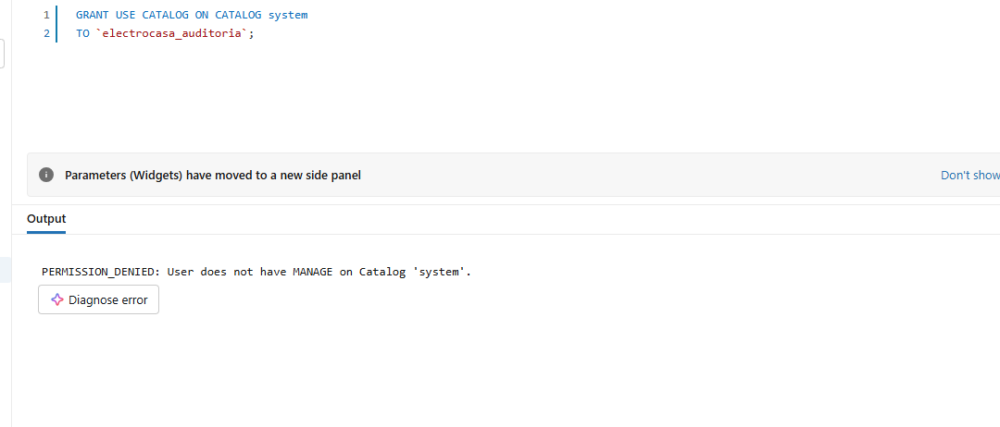

## 7. Lineage de Empleados

La vista de Lineage de Catalog Explorer muestra el origen `electrocasa.bronze.empleados_raw`, la materialized view `electrocasa.silver.empleados` y sus consumidores en Gold, incluyendo `ventas_por_vendedor_sucursal_mes` y `empleados_activos_sucursal_mes`.

Esta evidencia permite consultar visualmente el flujo de datos y las dependencias de la tabla de Empleados. Se utiliza como alternativa de auditoría debido a que Databricks Free Edition no permitió otorgar `MANAGE` sobre el catálogo `system`.

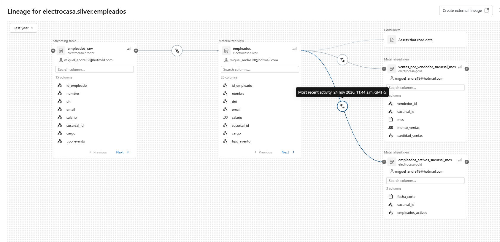

## 8. Permisos del esquema Bronze

La consulta `SHOW GRANTS ON SCHEMA electrocasa.bronze` muestra que `electrocasa_ingenieria` tiene los privilegios `CREATE TABLE`, `MODIFY`, `SELECT` y `USE SCHEMA` sobre Bronze.

En esta evidencia no aparecen los grupos `electrocasa_analistas` ni `electrocasa_auditoria` con permisos sobre Bronze.

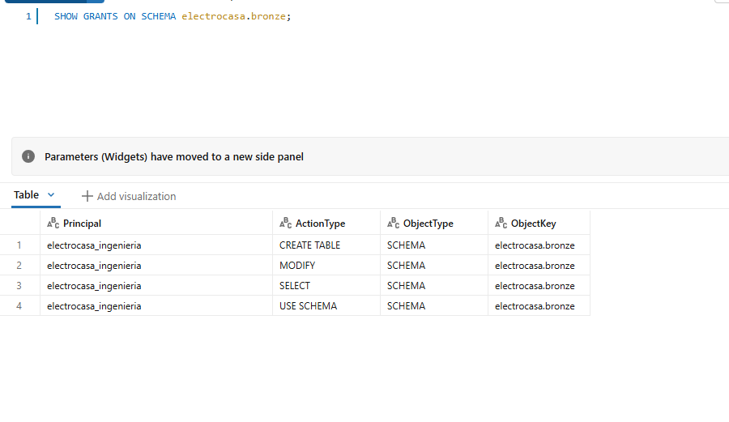

## 9. Permisos del esquema Gold

La consulta `SHOW GRANTS ON SCHEMA electrocasa.gold` muestra los siguientes permisos:

- `electrocasa_ingenieria`: `CREATE TABLE`, `MODIFY`, `SELECT` y `USE SCHEMA`.
- `electrocasa_analistas`: `SELECT` y `USE SCHEMA`.
- `electrocasa_auditoria`: `SELECT` y `USE SCHEMA`.

Estos permisos corresponden al acceso diferenciado esperado para el esquema Gold.

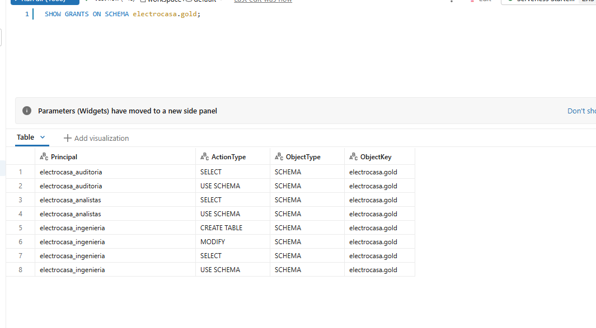

## Pendiente de completar

- Prueba de enmascaramiento con un usuario que no pertenezca a `electrocasa_ingenieria` (DNI enmascarado y salario oculto).
- Evidencia de que el propietario/usuario de ejecución del pipeline pertenece a `electrocasa_ingenieria` y de que las tablas derivadas conservan los valores reales.
- Verificación final de permisos efectivos y evidencias restantes que exija el enunciado.

No se debe afirmar que estas pruebas pendientes ya fueron realizadas.

## 10. Permisos del esquema Silver

La consulta `SHOW GRANTS ON SCHEMA electrocasa.silver` muestra que `electrocasa_ingenieria` conserva los privilegios `CREATE TABLE`, `MODIFY`, `SELECT` y `USE SCHEMA`.

Los grupos `electrocasa_analistas` y `electrocasa_auditoria` no aparecen con permisos sobre Silver. Además, la ausencia de `electrocasa_analistas` confirma que el `REVOKE SELECT` temporal realizado anteriormente tuvo efecto.

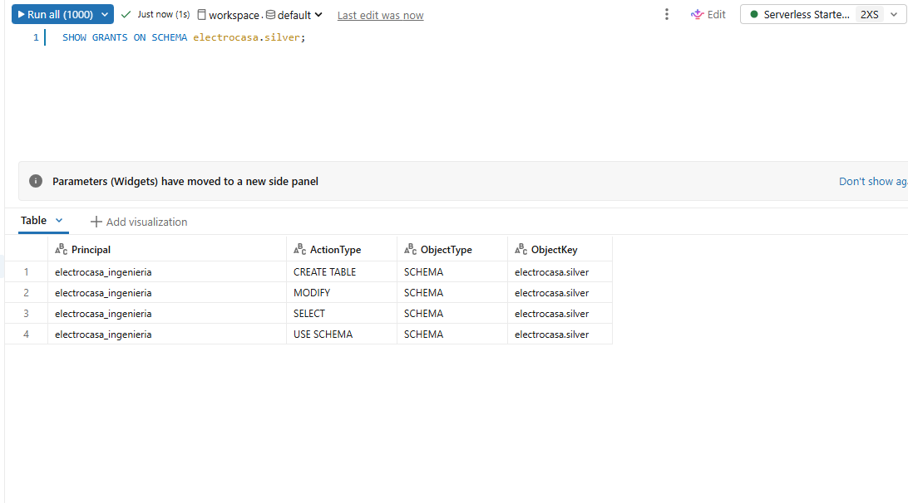

## 11. Propietario y usuario de ejecución del pipeline

La sección **Pipeline details** de `electrocasa_pipeline` muestra:

- **Creator:** `miguel_andre19@hotmail.com`
- **Owner:** `miguel_andre19@hotmail.com`
- **Run as:** `miguel_andre19@hotmail.com`
- **Run status:** `Completed`

La pertenencia de este usuario al grupo `electrocasa_ingenieria` fue comprobada previamente con `is_account_group_member('electrocasa_ingenieria')`, cuyo resultado fue `true`.

Por tanto, el propietario y usuario de ejecución del pipeline es miembro del grupo autorizado por el requisito de masking.

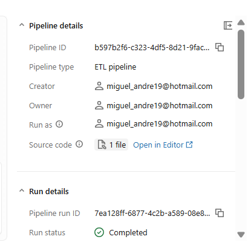

## 12. Tabla derivada Gold: empleados

Se creó la materialized view `electrocasa.gold.empleados` a partir de `electrocasa.silver.empleados`, declarando las máscaras para `dni` y `salario` en el esquema de la vista.

La consulta realizada por el usuario miembro de `electrocasa_ingenieria` muestra valores reales de DNI y salario. Esto es consistente con la regla de acceso definida para el grupo de Ingeniería.

Esta captura demuestra el resultado para el usuario de Ingeniería. No demuestra por sí sola cómo se visualizan los campos desde una cuenta que no pertenezca al grupo; no se dispone de un segundo usuario para realizar esa prueba en Free Edition.

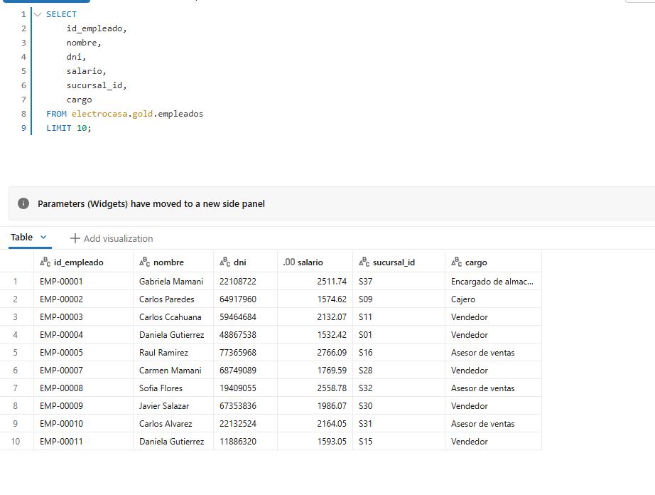

## 13. Máscaras en la vista materializada Gold

La consulta `SHOW CREATE TABLE electrocasa.gold.empleados` confirma que las columnas `dni` y `salario` tienen declaradas las funciones de máscara `electrocasa.silver.mask_dni` y `electrocasa.silver.mask_salario`.

Por tanto, las máscaras están definidas tanto en `electrocasa.silver.empleados` como en la vista materializada `electrocasa.gold.empleados`.

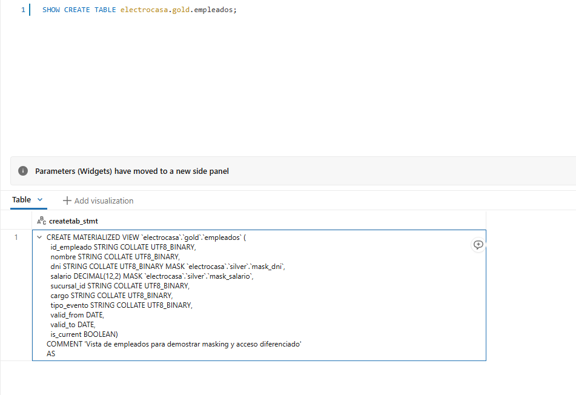

## Limitaciones de validación en Databricks Free Edition

No se dispone de un segundo usuario de Databricks para ejecutar una consulta como miembro de `electrocasa_analistas` o `electrocasa_auditoria`. Por ese motivo, no se presenta una captura de la visualización enmascarada desde esos grupos. Las evidencias disponibles muestran la definición de las máscaras y la consulta realizada por un miembro de `electrocasa_ingenieria`, que ve los valores reales.

La pertenencia del usuario de ejecución del pipeline a `electrocasa_ingenieria` se comprobó con `is_account_group_member('electrocasa_ingenieria') = true`, y el pipeline muestra ese mismo usuario en `Owner` y `Run as`.
