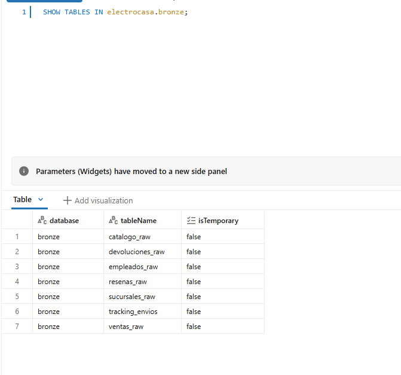
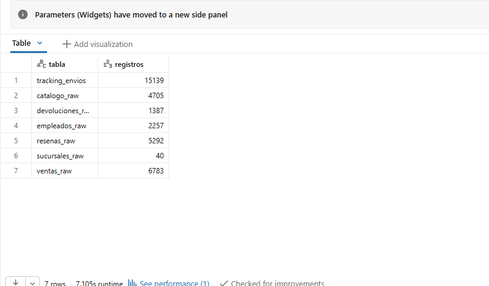
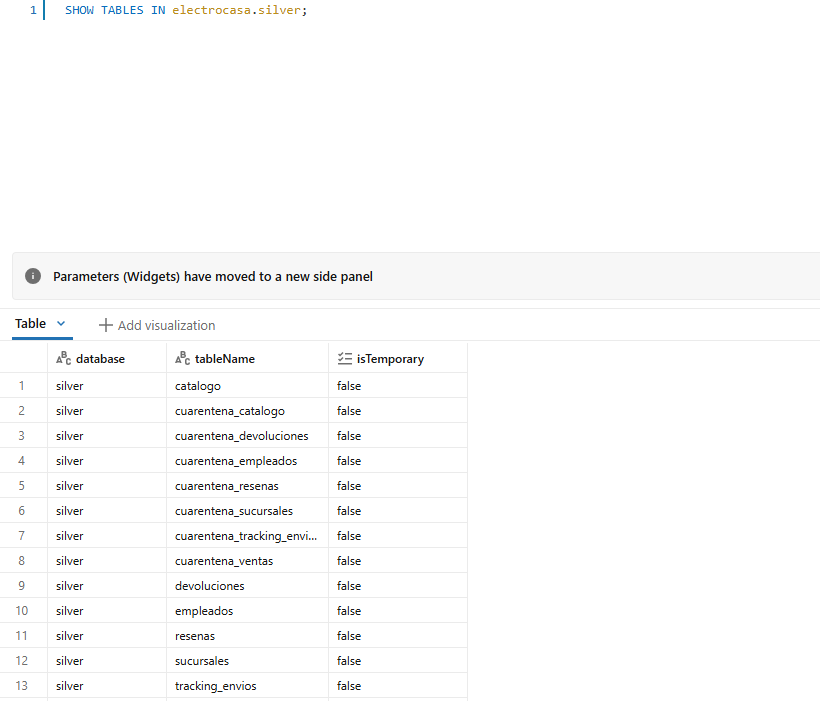
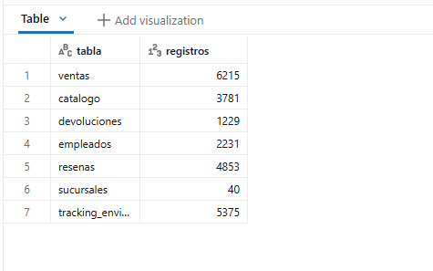
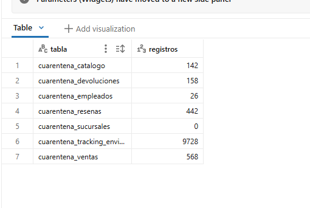
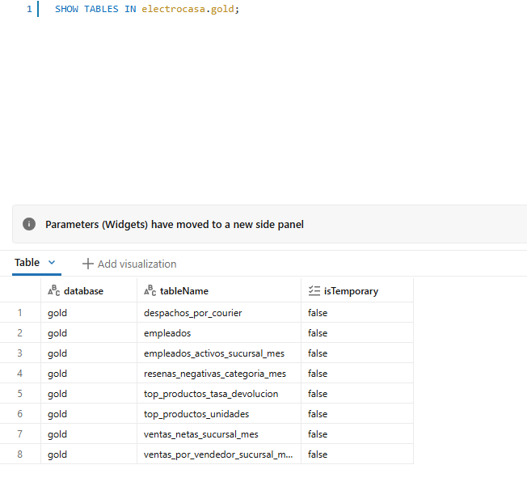
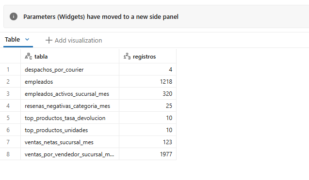

\# electrocasa-lakehouse

Plataforma de ingeniería de datos para una cadena de electrodomésticos usando Databricks y arquitectura Medallion.

\# Evidencias de gobierno y seguridad – ElectroCasa

\## 1. Grupo de Ingeniería

La captura muestra que \`electrocasa_ingenieria\` tiene como miembro al usuario del proyecto.

![Miembro de electrocasa_ingenieria]\(evidencias/01_grupo_ingenieria_miembro.png)

\## 2. Consulta de empleados con acceso de Ingeniería

La consulta de \`electrocasa.silver.empleados\` muestra los valores reales de DNI y salario para el usuario miembro de \`electrocasa_ingenieria\`.

![Resultado de DNI y salario]\(evidencias/02_masking_dni_salario_resultado.png)

\## 3. Definición de máscaras en la materialized view

\`SHOW CREATE TABLE\` confirma que las columnas \`dni\` y \`salario\` tienen asociadas las funciones de máscara \`mask_dni\` y \`mask_salario\`.

![SHOW CREATE TABLE con máscaras]\(evidencias/03_show_create_table_masks.png)

\## 4. GRANT temporal: antes del REVOKE

Se otorgó temporalmente \`SELECT\` al grupo \`electrocasa_analistas\` sobre el esquema \`electrocasa.silver\` para demostrar la revocación posterior.

![Analistas con SELECT sobre Silver]\(evidencias/04_grant_analistas_antes_revoke.png)

\## 5. REVOKE: después de revocar SELECT

Se revocó el permiso temporal \`SELECT\` de \`electrocasa_analistas\` sobre \`electrocasa.silver\`. La consulta \`SHOW GRANTS\` confirma que el grupo ya no aparece con ese permiso.

![Analistas sin SELECT sobre Silver]\(evidencias/05_revoke_analistas_despues.png)

\## 6. Acceso de Auditoría al catálogo \`system\`

Se intentó otorgar al grupo \`electrocasa_auditoria\` el privilegio \`USE CATALOG\` sobre el catálogo \`system\`:

\`\`\`sql

GRANT USE CATALOG ON CATALOG system

TO \`electrocasa_auditoria\`;

\`\`\`

**\*\*Resultado:\*\*** Databricks Free Edition rechazó la operación porque el usuario no tiene el privilegio \`MANAGE\` sobre el catálogo \`system\`.

Error obtenido:

\`\`\`text

PERMISSION_DENIED: User does not have MANAGE on Catalog 'system'.

\`\`\`

De acuerdo con las instrucciones del proyecto, al no poder otorgar estos permisos se utiliza la pestaña **\*\*Lineage\*\*** de Catalog Explorer como evidencia alternativa de auditoría.

**\*\*Captura del error:\*\***

![Error al otorgar permisos sobre el catálogo system]\(evidencias/06_error_permisos_catalog_system.png)

\## 7. Lineage de Empleados

La vista de Lineage de Catalog Explorer muestra el origen \`electrocasa.bronze.empleados_raw\`, la materialized view \`electrocasa.silver.empleados\` y sus consumidores en Gold, incluyendo \`ventas_por_vendedor_sucursal_mes\` y \`empleados_activos_sucursal_mes\`.

Esta evidencia permite consultar visualmente el flujo de datos y las dependencias de la tabla de Empleados. Se utiliza como alternativa de auditoría debido a que Databricks Free Edition no permitió otorgar \`MANAGE\` sobre el catálogo \`system\`.

![Lineage de electrocasa.silver.empleados]\(evidencias/07_lineage_empleados.png)

\## 8. Permisos del esquema Bronze

La consulta \`SHOW GRANTS ON SCHEMA electrocasa.bronze\` muestra que \`electrocasa_ingenieria\` tiene los privilegios \`CREATE TABLE\`, \`MODIFY\`, \`SELECT\` y \`USE SCHEMA\` sobre Bronze.

En esta evidencia no aparecen los grupos \`electrocasa_analistas\` ni \`electrocasa_auditoria\` con permisos sobre Bronze.

![SHOW GRANTS de Bronze]\(evidencias/08_grants_bronze.png)

\## 9. Permisos del esquema Gold

La consulta \`SHOW GRANTS ON SCHEMA electrocasa.gold\` muestra los siguientes permisos:

\- \`electrocasa_ingenieria\`: \`CREATE TABLE\`, \`MODIFY\`, \`SELECT\` y \`USE SCHEMA\`.

\- \`electrocasa_analistas\`: \`SELECT\` y \`USE SCHEMA\`.

\- \`electrocasa_auditoria\`: \`SELECT\` y \`USE SCHEMA\`.

Estos permisos corresponden al acceso diferenciado esperado para el esquema Gold.

![SHOW GRANTS de Gold]\(evidencias/09_grants_gold.png)

\## 10. Permisos del esquema Silver

La consulta \`SHOW GRANTS ON SCHEMA electrocasa.silver\` muestra que \`electrocasa_ingenieria\` conserva los privilegios \`CREATE TABLE\`, \`MODIFY\`, \`SELECT\` y \`USE SCHEMA\`.

Los grupos \`electrocasa_analistas\` y \`electrocasa_auditoria\` no aparecen con permisos sobre Silver. Además, la ausencia de \`electrocasa_analistas\` confirma que el \`REVOKE SELECT\` temporal realizado anteriormente tuvo efecto.

![SHOW GRANTS de Silver]\(evidencias/10_grants_silver.png)

\## 11. Propietario y usuario de ejecución del pipeline

La sección **\*\*Pipeline details\*\*** de \`electrocasa_pipeline\` muestra:

\- **\*\*Creator:\*\*** \`miguel_andre19\@hotmail.com\`

\- **\*\*Owner:\*\*** \`miguel_andre19\@hotmail.com\`

\- **\*\*Run as:\*\*** \`miguel_andre19\@hotmail.com\`

\- **\*\*Run status:\*\*** \`Completed\`

La pertenencia de este usuario al grupo \`electrocasa_ingenieria\` fue comprobada previamente con \`is_account_group_member('electrocasa_ingenieria')\`, cuyo resultado fue \`true\`.

Por tanto, el propietario y usuario de ejecución del pipeline es miembro del grupo autorizado por el requisito de masking.

![Propietario y Run as del pipeline]\(evidencias/11_pipeline_owner_run_as.png)

\## 12. Tabla derivada Gold: empleados

Se creó la materialized view \`electrocasa.gold.empleados\` a partir de \`electrocasa.silver.empleados\`, declarando las máscaras para \`dni\` y \`salario\` en el esquema de la vista.

La consulta realizada por el usuario miembro de \`electrocasa_ingenieria\` muestra valores reales de DNI y salario. Esto es consistente con la regla de acceso definida para el grupo de Ingeniería.

Esta captura demuestra el resultado para el usuario de Ingeniería. No demuestra por sí sola cómo se visualizan los campos desde una cuenta que no pertenezca al grupo; no se dispone de un segundo usuario para realizar esa prueba en Free Edition.

![Consulta de empleados Gold con usuario de Ingeniería]\(evidencias/12_gold_empleados_datos_reales.png)

\## 13. Máscaras en la vista materializada Gold

La consulta \`SHOW CREATE TABLE electrocasa.gold.empleados\` confirma que las columnas \`dni\` y \`salario\` tienen declaradas las funciones de máscara \`electrocasa.silver.mask_dni\` y \`electrocasa.silver.mask_salario\`.

Por tanto, las máscaras están definidas tanto en \`electrocasa.silver.empleados\` como en la vista materializada \`electrocasa.gold.empleados\`.

![SHOW CREATE TABLE de Gold con las máscaras]\(evidencias/13_masks_gold_empleados.png)

\## Limitaciones de validación en Databricks Free Edition

No se dispone de un segundo usuario de Databricks para ejecutar una consulta como miembro de \`electrocasa_analistas\` o \`electrocasa_auditoria\`. Por ese motivo, no se presenta una captura de la visualización enmascarada desde esos grupos. Las evidencias disponibles muestran la definición de las máscaras y la consulta realizada por un miembro de \`electrocasa_ingenieria\`, que ve los valores reales.

La pertenencia del usuario de ejecución del pipeline a \`electrocasa_ingenieria\` se comprobó con \`is_account_group_member('electrocasa_ingenieria') = true\`, y el pipeline muestra ese mismo usuario en \`Owner\` y \`Run as\`.

\## 14. Orquestación del proceso ETL

\### Job: \`electrocasa_tracking_ingestion job\`

Se configuró un Job para ejecutar secuencialmente las siguientes tareas:

1\. \`setup_y_copy_into\`: prepara los esquemas y volúmenes, y ejecuta la carga inicial mediante COPY INTO.

2\. \`electrocasa_tracking_ingestion_job\`: ejecuta el proceso de ingesta de tracking.

3\. \`pipeline_principal\`: ejecuta el pipeline ETL principal.

4\. \`validacion\`: ejecuta las validaciones finales del procesamiento.

La última ejecución completa del Job finalizó con estado **\*\*Succeeded\*\***. Las cuatro tareas aparecen conectadas secuencialmente y completadas correctamente.

![Job con las cuatro tareas secuenciales]\(evidencias/14_job_tareas_secuenciales.png)

\### Pipeline: \`electrocasa_pipeline\`

El pipeline implementa el procesamiento ETL mediante arquitectura Medallion, con las capas Bronze, Silver y Gold.

La última ejecución verificada, realizada el 24 de noviembre de 2026, finalizó con estado **\*\*Completed\*\***.

\- **\*\*Tipo:\*\*** ETL pipeline.

\- **\*\*Tablas:\*\*** 26.

\- **\*\*Errores:\*\*** 0.

\- **\*\*Advertencias:\*\*** 0.

\- **\*\*Creator, Owner y Run as:\*\*** usuario miembro de \`electrocasa_ingenieria\`.

![Pipeline completado con 26 tablas y sin errores ni advertencias]\(evidencias/15_pipeline_completado_26_tablas.png)

\## 15. Despliegue del Asset Bundle – target \`dev\`

Se validó la configuración del Asset Bundle con \`databricks bundle validate -t dev\`, obteniendo el resultado **\*\*Validation OK\*\***.

Antes del despliegue, \`databricks bundle plan -t dev\` mostró el siguiente plan:

\- Crear \`jobs.electrocasa_job\`.

\- Crear \`pipelines.electrocasa_pipeline\`.

\- 2 recursos por agregar, 0 por modificar, 0 por eliminar y 0 sin cambios.

Posteriormente se ejecutó \`databricks bundle deploy -t dev\`. La CLI confirmó el despliegue exitoso:

\- Pipeline creado: \`electrocasa_pipeline\`.

\- Job creado: \`electrocasa_job\`.

\- Archivos cargados: 30.

\- Recursos: 2 creados, 0 modificados, 0 eliminados y 0 sin cambios.

La evidencia corresponde al resultado de la CLI de Databricks del 24 de noviembre de 2026. Este despliegue acredita el target \`dev\`; el target \`prod\` está definido en \`databricks.yml\`, pero no se afirma que haya sido desplegado.

![Despliegue exitoso del Asset Bundle en dev]\(evidencias/16_bundle_deploy_dev.png)

\## 16. Evidencia de ingesta incremental de Tracking

Se verificaron dos ejecuciones completadas del pipeline de ingesta \`electrocasa_tracking_ingestion\`, ambas realizadas el 24 de noviembre de 2026:

\### Primera ejecución – 02:27 a. m.

\- **\*\*Estado:\*\*** Completed.

\- **\*\*Filas leídas:\*\*** 79,791.

\- **\*\*Bytes leídos:\*\*** 838.39 KB.

\- **\*\*Bytes escritos:\*\*** 280.28 KB.

La ejecución procesó datos en la tabla \`tracking_envios\`.

![Primera ejecución de Tracking: 79,791 filas leídas]\(evidencias/17_tracking_primera_ejecucion_79791_filas.png)

\### Segunda ejecución – 02:30 a. m.

\- **\*\*Estado:\*\*** Completed.

\- **\*\*Filas leídas:\*\*** 0.

\- **\*\*Bytes leídos:\*\*** 0 B.

\- **\*\*Bytes escritos:\*\*** 0 B.

La segunda ejecución terminó correctamente sin leer ni escribir nuevas filas, consistente con una ejecución incremental sin cambios pendientes.

![Segunda ejecución de Tracking: cero filas leídas y cero bytes escritos]\(evidencias/18_tracking_segunda_ejecucion_sin_nuevas_filas.png)

## 17. Inventario de tablas Bronze

La consulta `SHOW TABLES IN electrocasa.bronze` confirma la presencia de las tablas de entrada de la capa Bronze: `catalogo_raw`, `devoluciones_raw`, `empleados_raw`, `resenas_raw`, `sucursales_raw`, `tracking_envios` y `ventas_raw`.

### Conteos de registros Bronze

Los conteos obtenidos para las tablas Bronze son:

| Tabla | Registros |
|---|---:|
| `tracking_envios` | 15,139 |
| `catalogo_raw` | 4,705 |
| `devoluciones_raw` | 1,387 |
| `empleados_raw` | 2,257 |
| `resenas_raw` | 5,292 |
| `sucursales_raw` | 40 |
| `ventas_raw` | 6,783 |

## 18. Inventario y conteos de tablas Silver

La consulta `SHOW TABLES IN electrocasa.silver` muestra las tablas de la capa Silver, incluyendo las tablas transformadas y las tablas de cuarentena.

Los conteos de las tablas Silver transformadas son:

| Tabla | Registros |
|---|---:|
| `ventas` | 6,215 |
| `catalogo` | 3,781 |
| `devoluciones` | 1,229 |
| `empleados` | 2,231 |
| `resenas` | 4,853 |
| `sucursales` | 40 |
| `tracking_envios` | 5,375 |

## 19. Registros en cuarentena

Los conteos obtenidos para las tablas de cuarentena de Silver son:

| Tabla | Registros |
|---|---:|
| `cuarentena_catalogo` | 142 |
| `cuarentena_devoluciones` | 158 |
| `cuarentena_empleados` | 26 |
| `cuarentena_resenas` | 442 |
| `cuarentena_sucursales` | 0 |
| `cuarentena_tracking_envios` | 9,728 |
| `cuarentena_ventas` | 568 |

## 20. Inventario y conteos de tablas Gold

La consulta `SHOW TABLES IN electrocasa.gold` confirma la existencia de las tablas analíticas de la capa Gold.

Los conteos obtenidos son:

| Tabla | Registros |
|---|---:|
| `despachos_por_courier` | 4 |
| `empleados` | 1,218 |
| `empleados_activos_sucursal_mes` | 320 |
| `resenas_negativas_categoria_mes` | 25 |
| `top_productos_tasa_devolucion` | 10 |
| `top_productos_unidades` | 10 |
| `ventas_netas_sucursal_mes` | 123 |
| `ventas_por_vendedor_sucursal_mes` | 1,977 |

